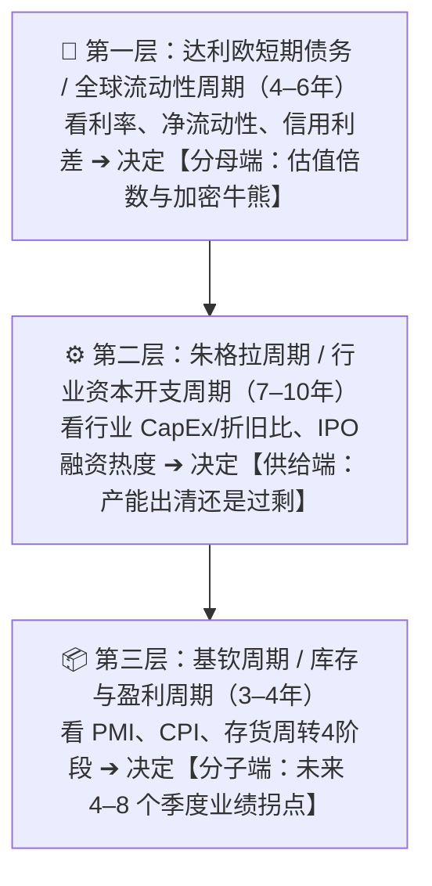

# 🧭 宏观周期与行业预期评分模型（三周期嵌套 × 15 维度）

> [!abstract] 为什么需要这把“中观尺子”
> [[选股评分模型]] 解决的是“这是不是一家好公司”，但实战中我们频繁遇到**“好公司，但买在了错误的宏观或行业周期位置”**（例如：在降息前夕买吃利息的 [[Circle CRCL]]，在全行业 CapEx 狂飙至折旧 6 倍时买 [[Alphabet GOOGL]] 或 [[SpaceX SPCX]]）。
> 本模型把庞杂的经济学周期理论去伪存真，浓缩成一套**可查客观数据、不靠算命预测、15 分钟内完成打分**的宏观与行业顺逆风评估工具。

---

## 🔪 零、周期理论去伪存真（我们用什么，不用什么）

面对市面上繁杂的周期流派，遵循 [[投资铁律]] #5 与 [[避坑检查表]] #3（**警惕物理学嫉妒与虚假精确**），我们做如下筛选：

| 周期理论 | 跨度 | 我们的态度 | 实战取舍理由 |
| :--- | :---: | :---: | :--- |
| **班纳周期（Benner Cycle）** | 固定年份图 | ❌ **直接剔除** | 1875 年的固定日历算命图，无视现代央行与法币流动性机制，属于典型的“刻舟求剑/虚假精确”，绝不采用。 |
| **康波周期（Kondratieff）** | 50–60 年 | 🔭 **降维作背景** | 跨度太长，无法指导 1–5 年股票买卖。仅吸收其核心思想：**看清当前 20 年的主导技术范式**（如 AI 与算力渗透率 S 曲线）。 |
| **达利欧长期债务周期** | 50–75 年 | 🔭 **降维作底仓信仰** | 解释大国法币超发与债务货币化。不用于短期择时，而是作为**长期配置 1–5% [[Bitcoin BTC]] 与黄金的底层逻辑**。 |
| **① 达利欧短期信贷 / 全球流动性周期** | **4–6 年** | ✅ **核心采用（第一层）** | **决定【分母端/估值与加密牛熊】**：美联储利率与资产负债表扩缩驱动，与比特币 4 年减半周期高度共振。 |
| **② 朱格拉周期（资本开支/供给周期）** | **7–10 年** | ✅ **核心采用（第二层）** | **决定【供给端/长期回报】**：即马拉松资本《资本周期》（铁律 #12、#13）。看全行业 CapEx/折旧比，产能出清时买、军备竞赛时逃。 |
| **③ 基钦周期（库存与盈利周期）** | **3–4 年** | ✅ **核心采用（第三层）** | **决定【分子端/1–2年景气拐点】**：40 个月库存循环（被动去库 $\to$ 主动补库 $\to$ 被动累库 $\to$ 主动去库），完美匹配 3 年 EV 测算周期。 |

---

## 🌡️ 上半场：美股 & 加密宏观温度计（7 大高频路标 $\to$ 四周期定位）

> [!tip] 用法
> 不看滞后的 GDP，只看以下 **3 组共 7 个公开高频指标**，用 5 分钟判断当前整体市场处于哪一个经济周期象限，决定总仓位与攻防方向。

### 1. 七大宏观路标检查表

| 组别 | # | 核心路标 | 看什么（实战判断标准） | 当前状态记录（使用时填写） |
| :--- | :---: | :--- | :--- | :--- |
| **A. 增长与通胀** *(定经济象限)* | 1 | **ISM 制造业 / 服务业 PMI** | 50 为荣枯线；重点看**连续 3 个月边际方向**，以及**新订单 − 客户库存**差值（领先指标） | |
| | 2 | **通胀双锚：核心 CPI / PCE（滞后）+ WTI 原油价格（高频先行）** | • **CPI**：向 2% 回落（宽松打开）vs 二次抬头（被迫紧缩） • **WTI 原油三档警戒线**：🟢 **\$60–\$80 舒适区**（利好科技/消费/加密）｜🟡 **\$80–\$90 警戒区**（通胀黏性抬头）｜🔴 **>\$90–\$100 滞胀红线**（供给冲击引发股债币三杀；若 **<\$55** 则预警全球需求坍塌） | |
| **B. 货币与流动性** *(定分母松紧)* | 3 | **美联储利率方向 & 2Y 美债收益率** | 2 年期美债收益率领先联邦基金利率，直接反映市场对未来 1–2 年降息/加息的真实定价 | |
| | 4 | **10Y 实际利率（TIPS）、美元（DXY）与黄金（GC=F）& 金油比** | • **10Y TIPS**：>2% 对长久期资产构成强重力压制 • **黄金（GC=F）**：达利欧长债务周期与法币信用贬值的真实照妖镜，亦是 [[Bitcoin BTC]] 的领先参照系 • **金油比（黄金÷原油，均值 15–25）**：🚨 **>30–35 预警经济衰退/黑天鹅与随后的救市大放水**；**<12–15 预警恶性石油通胀与暴力加息** | |
| | 5 | **美联储净流动性 & 全球 M2** | `净流动性 = 美联储总资产 − TGA财政部账户 − RRP逆回购`；决定市场真金白银是在放水还是抽水 | |
| **C. 信用与恐慌** *(定拐点与危机)* | 6 | **高收益债信用利差（HY OAS）** | **煤矿里的金丝雀**：<3.5% 说明企业违约风险极低（软着陆）；一旦突破 5–6% 飙升，拉响系统性危机警报 | |
| | 7 | **VIX 恐慌指数** | **反人性温度计**：<14 代表市场极度自满（容易见阶段顶）；**>35–40 代表极度恐慌抛售（历史级抄底信号）** | |

### 2. 经济周期四象限落位（注意：股市永远领先实体经济约 6 个月）

| 经济周期象限 | 七大路标组合特征 | 总体仓位与现金策略（对应 [[投资铁律]] #24） | 五大赛道顺逆风总排序 |
| :--- | :--- | :--- | :--- |
| **🌱 一、复苏期** *(Early Cycle)* | • **PMI** 在 50 下方触底回升，新订单 > 库存 • **CPI** 温和回落 • **利率** 处于降息通道，净流动性扩张 • **信用利差** 从高位快速收窄 | **积极进攻**：降低现金比例，拉满优质成长与早周期资产仓位 | 🟢 **最顺风**：**① AI 与科技硬件**、**② 加密与金融科技**、**③ 可选消费** 🟡 **回暖**：**④ 生物医药（Biotech）**（融资成本下降） 🔴 **落后**：纯吃利息模式（如 Circle） |
| **🔥 二、扩张/过热期** *(Mid-to-Late Cycle)* | • **PMI** >53 高位运行 • **CPI** 开始触底反弹 • **利率** 停止降息甚至预期加息 • **VIX** <15，全市场乐观，企业疯狂投 CapEx | **去弱留强，警惕供给泡沫**：逐步兑现高估值题材，转向有真实业绩和涨价能力的标的 | 🟢 **最顺风**：**⑤ 能源与资源**（抗通胀）、**① 科技龙头**（业绩兑现，但严防 CapEx 见顶） 🟡 **分化**：**② 金融科技**（高利率利好收息，但杀估值） 🔴 **承压**：无利润概念股 |
| **🌩️ 三、滞胀/紧缩期** *(Stagflation)* | • **PMI** 掉头向下逼近或跌破 50 • **CPI** 依然顽固高企 • **实际利率** 与美元飙升，净流动性收缩 • **信用利差** 开始走阔 | **全面防守（本金保值第一，铁律 #9）**：大幅提高现金（看涨期权）比例，砍掉高估值与高负债公司 | 🟢 **仅存顺风**：**⑤ 能源资源 / 黄金**、**④ 大型医药龙头**、**③ 必需消费**（刚需+强定价权） 🔴 **戴维斯双杀**：**① 高估值科技/AI**、**② 加密货币**、**④ 未盈利 Biotech** |
| **❄️ 四、衰退/出清期** *(Recession / Capitulation)* | • **PMI** 深度跌破 50（如 <47） • **CPI** 快速回落 • **信用利差** 暴涨，**VIX >35** 恐慌清算 • **美联储** 被迫紧急大幅降息 / 重启扩表 | **前半场守现金，后半场下重注（铁律 #20）**：当 VIX 极值 + 央行救市大放水出现时，动用冗余现金抄底顶级资产 | 🟢 **前半场**：现金、医药、必需消费 🎯 **后半场（黄金坑）**：全市场恐慌错杀时，左侧重仓 **① 顶级科技巨头** 与 **② BTC / 加密核心资产** |

---

## 🎯 中场：五大核心赛道 × 三周期传导速查矩阵

> [!important] 核心认知
> 同一个宏观变量（比如降息或通胀），对不同赛道的影响往往是**截然相反**的。打分前先对照下表找准该赛道的**“核心胜负手”**：

| 关注赛道 | 决定命运的主导周期（胜负手） | 🟢 5 分极佳顺风状态（什么时候买？） | 🔴 1 分极度逆风 / 避雷状态（什么时候逃？） |
| :--- | :--- | :--- | :--- |
| **① AI 与科技硬件** *(算力/芯片/云/终端)* | **朱格拉资本周期（CapEx）** + **基钦库存周期** | • **基钦**：渠道去库存结束，新产品 S 曲线刚从 1% 迈向 10% • **朱格拉**：大厂 CapEx 刚启动，且增量回报（ROIIC）极高 | • **朱格拉见顶**：**行业 CapEx/折旧比 >4x**，大厂靠发债/停回购硬撑军备竞赛（如 Q3 2026 的 Google/SpaceX） • **基钦**：下游客户重复下单（Double Booking）后开始砍单累库 |
| **② 加密与金融科技** *(BTC/公链/交易所/稳定币)* | **达利欧全球流动性周期** + **监管立法周期** | • **流动性**：美联储降息扩表 + 全球 M2 拐头向上 • **出清度**：经历深熊洗牌（如连环爆仓后）、ETF 资金流出见底、矿工投降 • **监管**：重磅合规法案（如 GENIUS 法案）打开机构入口 | • **流动性抽水**：美联储加息缩表 • **情绪顶**：新币/山寨币一年暴涨数十倍（如 ZEC）、高 FDV 低流通 VC 币泛滥（如 CT）、全网高杠杆逼空 • *特例：稳定币收息股（Circle）在降息周期分子端受损* |
| **③ 消费** *(可选消费 vs 必需消费)* | **基钦库存周期** + **居民实际购买力** | • **基钦**：渠道去库彻底，终端动销回暖（被动去库转主动补库） • **定价权**：龙头顺利提价超过通胀且不丢份额，原材料成本回落（毛利扩张） | • **渠道堰塞湖**：厂家向经销商压货粉饰报表，终端动销停滞（被动累库） • **消费降级**：高通胀/高利率榨干中产储蓄，行业陷入恶性价格战 |
| **④ 医药** *(Big Pharma vs Biotech)* | **分母端利率（针对 Biotech）** + **产品管线/政策周期** | • **利率**：降息周期开启，一级市场生物科技融资解冻 • **产业**：重磅突破性大单品（如 GLP-1 等）处于放量早期，无近期专利悬崖 | • **高利率寒冬**：实际利率高企导致未盈利 Biotech 现金流断裂、破产潮 • **政策与专利**：医保控费法案强力砍价，或核心现金牛药物面临集中专利到期 |
| **⑤ 能源与资源** *(油气/铜金/矿产)* | **朱格拉长周期供给约束** + **美元与通胀周期** | • **供给端（最关键）**：**过去 5–10 年全行业 CapEx 极度匮乏**（ESG 限制或长期低价导致无人开新矿/新井），全行业亏损但需求刚性（铁律 #12） | • **供给洪峰**：连续多年高油价/高矿价刺激全行业疯狂扩产、并购，新产能集中投产；同时全球 PMI 跌破 50 进入衰退 |

---

## 📐 下半场：五大齿轮 · 15 维度行业预期打分表

> [!warning] 评分标准与权重分级
> **5** = 极强顺风 / 周期底部黄金坑｜**4** = 温和顺风｜**3** = 中性 / 分化｜**2** = 温和逆风｜**1** = 极强逆风 / 周期顶部泡沫
> - **⭐ 权重 3（5 项核心胜负手）**：分别对应五大齿轮的灵魂指标。**若任一 ⭐ 项 = 1 分（特别是 #4 供给端泡沫 或 #13 情绪极度拥挤），触发行业级避雷预警！**
> - **权重 2（8 项重要支撑）**
> - **◦ 权重 1（2 项辅助项）**
> - **满分** = 5×3×5 + 8×2×5 + 2×1×5 = **165 分**

### 齿轮一：💧 货币与宏观经济周期（达利欧流动性周期 · 4–6 年）

| # | 评估维度 | 权重 | 看什么 | 5 分（极佳顺风） | 1 分（极度逆风） |
| :---: | :--- | :---: | :--- | :--- | :--- |
| **1** | **经济周期象限匹配度** | **3 ⭐** | 当前处于【复苏/过热/滞胀/衰退】哪一格？目标行业在该象限的历史胜率如何？ | 处于该行业最擅长的顺风象限（或衰退末期恐慌见底向复苏切换的前夜） | 处于该行业最致命的逆风象限（如滞胀期买高估值科技/加密，或降息期买纯收息股） |
| **2** | **利率与美元传导净效应** | **2** | 利率（2Y/10Y TIPS）与美元（DXY）方向，对行业**分子（利润）+ 分母（估值/融资）**的综合影响 | 分子分母双重受益（如降息之于优质成长/黄金/BTC，或高利率之于零负债现金牛） | 分子或分母遭受重创（如高利率抽干高负债/未盈利行业，或降息砍掉吃息行业利润） |
| **3** | **宏观净流动性与信用利差** | **2** | 美联储净流动性、全球 M2 增速、高收益债利差（HY OAS） | 央行扩表/放水，信用利差平稳或从高位回落，资金充裕 | 央行缩表抽水，或信用利差急剧飙升引发流动性枯竭 |

### 齿轮二：📦 行业资本周期 / 供给端（朱格拉周期 · 7–10 年，源自《资本周期》）

| # | 评估维度 | 权重 | 看什么 | 5 分（极佳顺风） | 1 分（极度逆风） |
| :---: | :--- | :---: | :--- | :--- | :--- |
| **4** | **行业 CapEx / 折旧比与扩产强度** | **3 ⭐** | 全行业资本开支除以折旧的倍数；固定资产增速（[[投资铁律]] #13） | **过去 3–5 年全行业 CapEx 低迷（<折旧）**，无人扩产，未来供给极度稀缺 | **全行业军备竞赛，CapEx/折旧比飙升（>3–4x）**，巨头不惜发债/停回购抢产能 |
| **5** | **一级融资、IPO 与并购热度** | **2** | 行业内 VC 融资额、IPO 数量与募资规模、高溢价并购频率 | 行业无人问津，IPO 绝迹，VC 不敢投，并购全是破产清算价 | **史上最大规模 IPO 频出**（如 SpaceX），VC 疯狂撒钱，高估值帝国式并购盛行 |
| **6** | **竞争格局与产能出清信号** | **2** | 行业内二三线玩家是否在亏损、倒闭、退产能？CR4 龙头集中度变化 | 中小玩家成批倒闭退出（如矿工关机投降），活下来的龙头躺赢份额 | 新进入者蜂拥而至（跨界巨头纷纷杀入），价格战一触即发 |

### 齿轮三：📈 行业需求、库存与盈利周期（基钦周期 · 3–4 年）

| # | 评估维度 | 权重 | 看什么 | 5 分（极佳顺风） | 1 分（极度逆风） |
| :---: | :--- | :---: | :--- | :--- | :--- |
| **7** | **基钦库存 / 订单周期位置** | **3 ⭐** | 处于【被动去库 $\to$ 主动补库 $\to$ 被动累库 $\to$ 主动去库】4 阶段的哪一格？（无库存行业见下方等效指标表） | **阶段 ① 被动去库**（需求初醒、库存见底，最佳拐点）或 **阶段 ② 主动补库初期**（量价齐升） | **阶段 ③ 被动累库**（需求见顶、存货暴增）或 **阶段 ④ 主动去库初期**（杀业绩杀估值） |
| **8** | **渗透率 S 曲线与盈利二阶导** | **2** | 行业渗透率处于 0–1、1–10 还是 >50%？营收与利润增速是在加快还是放缓？ | 处于 1% $\to$ 10%–30% 的甜蜜加速期，或成熟行业迎来业绩增速向上拐点 | 渗透率已饱和（>70%），且营收/利润增速从高位掉头向下（二阶导为负） |
| **9** | **行业整体定价权与毛利趋势** | **2** | 行业整体能否顺畅提价转嫁原材料與**能源/油气成本（WTI原油/电价）**？全行业平均毛利率走势 | 供不应求，面对油气/算力能耗/原材料成本波动可 100% 顺畅提价转嫁，毛利率持续走高 | 同质化内卷，油价/电价/原材料上升无法转嫁給下游，全行业靠降价促销抢客户 |

> [!tip] 补丁：#7 基钦周期在“无物理库存行业”中的等效观测指标
> 软件、云计算、医药研发、金融服务等行业没有传统仓库存货，打第 7 项时自动切换为以下**等效订单/景气周期指标**：
>
> | 行业类型 | 替代“物理库存”的等效核心指标 | 🟢 5 分（被动去库 / 主动补库初期） | 🔴 1 分（被动累库 / 主动去库初期） |
> | :--- | :--- | :--- | :--- |
> | **硬件 / 制造 / 消费 / 能源** | **存货周转天数 (Inventory Days)** + **ISM PMI (新订单 − 客户库存)** | 渠道库存天数降至历史低位，新订单刚越过库存线向上 | 渠道压货严重、周转天数飙升，下游取消订单（Double Booking 反噬） |
> | **云计算 / 软件 SaaS** | **剩余履约义务 (RPO / Backlog) 增速** + **净美元留存率 (NDR)** | RPO 增速连续 2 季加快且 > 当期营收增速，企业 IT 预算扩张 | RPO 增速掉头向下 < 营收增速，客户缩减席位或拉长审批周期 |
> | **医药研发 (Biotech / CXO)** | **大药企 BD 首付款总额 & 询单/在手订单增速** + **一级投融资额** | 大药企现金充裕密集采购外部管线（高首付 BD 频出），CXO 新签订单加速 | 一级融资冰封，大药企砍研发预算、退回合作管线，CXO 订单取消率上升 |
> | **加密 / 交易所 / 金融科技** | **交易所稳定币沉淀量** + **托管资产 (AUC) & 换手率拐点** | 浮筹抛压枯竭（长期持有者占比创新高），场内稳定币余额触底回升 | 散户杠杆资金费率极高，矿工/早期巨鲸向交易所大额充值抛售 |

### 齿轮四：🏛️ 政策、监管与技术范式冲击

| # | 评估维度 | 权重 | 看什么 | 5 分（极佳顺风） | 1 分（极度逆风） |
| :---: | :--- | :---: | :--- | :--- | :--- |
| **10** | **监管立法与产业政策顺逆风** | **3 ⭐** | 核心法域是否有里程碑立法（给牌照/减税/补贴）或致命监管打击（禁令/拆分/控价）？ | 重磅利好立法落地（如稳定币 GENIUS 法案），或反垄断最大危机解除（如 Google 免于拆分） | 明确的执行禁令倒计时（如欧盟 AMLR 禁匿名币）、严厉价格管制或反垄断强制拆分 |
| **11** | **地缘政治与供应链安全** | **1 ◦** | 关税、出口管制、地缘冲突对行业供应链和海外收入的冲击 | 本土闭环或受益于供应链重构、自主可控与国防开支 | 核心产能或市场处于地缘风暴眼，面临断供或制裁没收风险 |
| **12** | **技术范式关系（赋能 vs 颠覆）** | **1 ◦** | 在康波级别的新技术（如 AI）面前，该行业是卖铲人/受益者，还是被替代者？ | 新技术直接降低行业成本或创造全新付费场景，加深护城河 | 商业模式存在被新技术“App 化/免费化”颠覆的长期风险 |

### 齿轮五：🌡️ 市场情绪、估值分位与拥挤度（反人性赔率端）

| # | 评估维度 | 权重 | 看什么 | 5 分（极佳顺风） | 1 分（极度逆风） |
| :---: | :--- | :---: | :--- | :--- | :--- |
| **13** | **行业估值分位与叙事热度** | **3 ⭐** | 行业整体 PE/PB/PS 处于过去 5–10 年什么分位？媒体与社交平台情绪如何？ | **估值处于历史 <20% 分位**，全网悲观厌恶、无人问津（[[投资铁律]] #12） | **估值处于历史 >90% 分位**，街头巷尾热议，到处高喊“这次不一样”（漂亮 50 陷阱） |
| **14** | **机构持仓拥挤度与资金流向** | **2** | 基金经理调查（如 BofA FMS）超配比例、行业 ETF 连续净流入/流出情况 | 机构极度低配，行业 ETF 经历连续数月净流出后开始企稳（卖盘枯竭） | 全市场第一大拥挤交易，机构全员满仓超配（边际买家枯竭） |
| **15** | **行业杠杆率与被动平仓风险** | **2** | 行业内公司的债务到期墙，以及二级市场融资盘/合约杠杆率、加杠杆囤货实体 | 杠杆已彻底出清，行业内公司普遍净现金 | 充斥高杠杆合约逼空，或存在巨额举债买资产的脆弱结构（[[避坑检查表]] #8、#9） |

---

## 📋 行业预期打分模板（复制到行业研究或个股笔记）

**评估行业**：`{{行业/赛道名称}}`　　**评估日期**：`{{YYYY-MM-DD}}`　　**当前宏观象限**：`复苏 / 过热 / 滞胀 / 衰退`

| # | 齿轮分类 | 评估维度 | 权重 | 评分(1-5) | 加权分 | 客观数据与依据 |
| :---: | :--- | :--- | :---: | :---: | :---: | :--- |
| 1 | 💧 流动性周期 | **经济周期象限匹配度** | **3 ⭐** | | | |
| 2 | 💧 流动性周期 | 利率与美元传导净效应 | 2 | | | |
| 3 | 💧 流动性周期 | 宏观净流动性与信用利差 | 2 | | | |
| 4 | 📦 朱格拉周期 | **行业 CapEx / 折旧比与扩产强度** | **3 ⭐** | | | |
| 5 | 📦 朱格拉周期 | 一级融资、IPO 与并购热度 | 2 | | | |
| 6 | 📦 朱格拉周期 | 竞争格局与产能出清信号 | 2 | | | |
| 7 | 📈 基钦周期 | **基钦库存 / 订单周期位置** | **3 ⭐** | | | |
| 8 | 📈 基钦周期 | 渗透率 S 曲线与盈利二阶导 | 2 | | | |
| 9 | 📈 基钦周期 | 行业整体定价权与毛利趋势 | 2 | | | |
| 10 | 🏛️ 政策与范式 | **监管立法与产业政策顺逆风** | **3 ⭐** | | | |
| 11 | 🏛️ 政策与范式 | 地缘政治与供应链安全 | 1 ◦ | | | |
| 12 | 🏛️ 政策与范式 | 技术范式关系（赋能 vs 颠覆） | 1 ◦ | | | |
| 13 | 🌡️ 情绪与拥挤 | **行业估值分位与叙事热度** | **3 ⭐** | | | |
| 14 | 🌡️ 情绪与拥挤 | 机构持仓拥挤度与资金流向 | 2 | | | |
| 15 | 🌡️ 情绪与拥挤 | 行业杠杆率与被动平仓风险 | 2 | | | |
| | | **合计** | **33** | | **___ / 165** | **得分率：___ %** |

---

## 🔗 结论判定与【个股 / 加密评分模型】联动规则（用法 3）

算出行业的**综合得分率（加权分 ÷ 165）**，并检查 **三周期共振状态（#1 流动性、#4 朱格拉供给、#7 基钦库存）** 后，按以下硬规则直接回填到你的 [[选股评分模型]] 与 [[加密资产评分模型]] 中：

### 1. 四档行业定性与联动公式

| 行业得分率 | 周期定性 | 回填 [[选股评分模型]] #28–30 项 | 回填 [[加密资产评分模型]] #19 项 | 组合仓位乘数（联动 [[投资铁律]] #20） |
| :---: | :--- | :--- | :--- | :--- |
| **$\ge$ 80%** *(且 #1、#4、#7 均 $\ge$4 分)* | 🔥 **三周期共振向上** *(十年一遇黄金顺风)* | `#30 资本周期` = **5 分** `#28 恐慌/时机` = **4–5 分** | `#19 周期位置` = **5 分** | **重注区（1.0x–1.2x 上限）**：个股得分 $\ge$75% 即可给满单票仓位上限（8–10%） |
| **65% – 79%** | 🟢 **温和顺风 / 结构景气** | `#30 资本周期` = **4 分** | `#19 周期位置` = **4 分** | **标准区（0.8x–1.0x 上限）**：正常按个股得分建仓（5–8%） |
| **50% – 64%** | 🟡 **周期错位 / 震荡分化** *(如需求好但供给过热)* | `#30 资本周期` = **2–3 分** | `#19 周期位置` = **2–3 分** | **观察/折价区（$\le$ 0.5x 上限）**：严控仓位（$\le$ 3–4%），只买估值有深度安全边际的绝对龙头 |
| **< 50%** *(或 #4、#13 任一项 = 1 分)* | 🔴 **三周期共振向下 / 泡沫顶** *(行业级避雷)* | **`#30 资本周期` 强制锁定 1 分** | **`#19 周期位置` 强制锁定 1 分** | **一票暂缓（0% 仓位）**：哪怕公司质地再好（如当前 Google 68.5%、SpaceX 54.5%），也**禁止新建重仓**，强制等待 CapEx 或估值出清拐点！ |

### 2. 当前已分析标的的中观映射示例（2026-11 快照）

| 赛道 / 标的 | #1 流动性周期 | #4 朱格拉供给 (CapEx) | #7 基钦库存/需求 | #13 估值与拥挤度 | 周期诊断结论 |
| :--- | :---: | :---: | :---: | :---: | :--- |
| **AI 算力与云基建** ([[Alphabet GOOGL]], [[SpaceX SPCX]]) | 3 分 | **1 分** 🔴 *(CapEx/折旧 6.1x)* | 5 分 *(云需求翻倍)* | 2 分 *(极度拥挤)* | **典型“基钦好、朱格拉见顶”周期错位** $\to$ 解释了为何 Google 质地满分却必须等 CapEx 拐点 |
| **合规稳定币发行** ([[Circle CRCL]]) | **2 分** 🔴 *(降息压制分子)* | 2 分 *(银行/巨头涌入)* | 3 分 *(流通量仅+8%)* | 2 分 *(PE 50x)* | **利率逆风 + 供给涌入** $\to$ 继续观察 |
| **加密头部资产与平台** ([[Bitcoin BTC]], [[Coinbase COIN]]) | 3 分 | 4 分 *(矿工投降/洗牌)* | 3 分 | **4 分** 🟢 *(回撤40%/ETF流出)* | **情绪与供给已出清大半** $\to$ BTC 可分批定投，COIN 等 SBC 改善或深熊 |
| **暴涨隐私币 / 新发 VC 币** ([[Zcash ZEC]], [[Concrete CT]]) | 3 分 | **1 分** 🔴 *(算力涌入 / 81%待解锁)* | 2 分 | **1 分** 🔴 *(涨20倍逼空)* | **周期顶部 / 供给洪峰** $\to$ 坚决不碰 |

---

## 🔗 相关笔记

- [[投资清单总览]] — 投资体系总导航
- [[选股评分模型]] — 个股 30 维度微观体检（本模型直接赋能其第 28–30 项）
- [[加密资产评分模型]] — 加密资产 21 维度体检（本模型直接赋能其第 14–16、19 项）
- [[投资铁律]] — 重点对照 #5（拒绝虚假精确）、#12（周期品悲观时买）、#13（警惕高资本开支）、#20（三周期共振时下重注）、#24（现金是看涨期权）
- [[避坑检查表]] — 重点对照 #3（物理学嫉妒）、#6（IPO 狂热）、#7（资本周期顶部）
