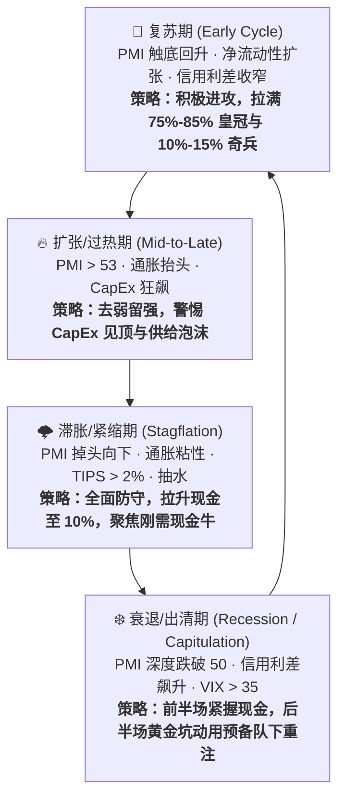

# 🌡️ 宏观温度计（7 大高频路标 × 经济四象限统一基准）

> [!abstract] 核心定义与定位
> 本文档是整个投资第二大脑的**宏观与流动性权威定义源**。
> 遵循 [[投资铁律]] #5 与 [[避坑检查表]] #3（**警惕物理学嫉妒与虚假精确**），我们拒绝算命式的宏观预测，只追踪 **3 组共 7 个公开高频硬指标**，用于定量判断当前市场处于哪一个经济周期象限，从而指导全资产三大配置池（75%–85% 皇冠、10%–15% 奇兵、5%–10% 现金）的攻防平衡。
> 
> **联动工具**：
> - 行业打分与赛道顺逆风 $\implies$ [[宏观周期与行业预期评分模型]]
> - 个股研究宏观属性 $\implies$ [[_选股分析模板]]（YAML `macro_score` 与 `macro_bucket`）
> - 每日动态监测 $\implies$ [[05_每日情报]]

---

## 🧭 一、七大高频宏观路标权威基准

| 组别 | # | 核心路标 | 看什么（实战量化判断标准） | 🟢 宽松/利好临界 | 🔴 紧缩/风险警戒红线 |
| :--- | :---: | :--- | :--- | :--- | :--- |
| **A. 增长与通胀** *(定经济象限)* | 1 | **ISM 制造业 / 服务业 PMI** | 50 为荣枯线；核心看**连续 3 个月边际趋势**及【新订单 − 客户库存】领先剪刀差 | 连续 3 个月 >50 且新订单 > 客户库存 | 连续跌破 48–50，且新订单明显衰退 |
| | 2 | **通胀双锚：核心 CPI/PCE + WTI 原油** | • **核心 CPI**：向 2% 靠拢（货币宽松空间打开）vs 二次抬头 • **WTI 原油价格**：高频能源成本领先指标 | **\$60–\$80 舒适区**（通胀温和，利好科技/消费/加密） | **>\$90–\$100 滞胀红线**（引发股债币三杀；若 **<\$55** 预警全球需求硬着陆） |
| **B. 货币与流动性** *(定分母松紧)* | 3 | **美联储利率 & 2Y 美债收益率** | 2 年期美债收益率领先美联储利率，反映市场对未来 1–2 年货币紧缩/宽松的真实计价 | 2Y 收益率破位下行（降息通道打开） | 2Y 收益率突破上行并倒挂（资金紧缩压力） |
| | 4 | **10Y 实际利率 (TIPS) & 黄金金油比** | • **10Y TIPS**：无风险真实资金成本，对长久期资产构成强重力压制 • **金油比（黄金÷原油，均值 15–25）**：黄金是法币信用贬值与避险照妖镜 | 10Y TIPS < 1.5% 且下行 金油比处于 15–22 健康带 | **10Y TIPS > 2.0%**（长久期资产严重受压） 🚨 **金油比 > 30–35**（预警大衰退/黑天鹅） 🚨 **金油比 < 12–15**（恶性石油通胀与加息） |
| | 5 | **美联储净流动性 & 全球 M2** | `净流动性 = 美联储总资产 − TGA 财政部账户 − RRP 逆回购`；决定金融系统真金白银放水还是抽水 | 净流动性环比连续扩张、M2 增速转正 | 净流动性持续抽水，TGA 猛增抽干银行储备 |
| **C. 信用与恐慌** *(定拐点与危机)* | 6 | **高收益债信用利差（HY OAS）** | **企业违约与信贷违约的“金丝雀”** | **< 3.5%**（企业违约风险极低，信贷畅通） | **突破 5.0%–6.0%**（信贷市场冻结，系统性危机爆发） |
| | 7 | **VIX 恐慌指数** | **反人性的买卖情绪温度计** | **< 14 极度自满**（适合逢高止盈，严防黑天鹅） | **> 35–40 极度恐慌**（历史级黄金坑捡便宜筹码机会） |

---

## 🔄 二、经济周期四象限落位与全组合攻防策略

股市通常**领先实体经济约 6 个月**。根据 7 大路标组合落位四象限，严格执行组合攻防策略：

| 象限 | 核心路标组合特征 | 总体仓位与现金配置纪律 | 最顺风与最逆风赛道 |
| :--- | :--- | :--- | :--- |
| **🌱 一、复苏期** *(Early Cycle)* | • PMI 在 50 下方触底反弹，新订单 > 库存 • 通胀温和回落 • 处于降息通道，净流动性扩张 • 信用利差从高位快速收敛 | **积极进攻**：保持现金在 5% 下限，拉满顶级成长与早周期资产仓位 | 🟢 **顺风**：AI 与前沿科技、加密与金融科技、可选消费 🔴 **逆风**：纯收息类公司（降息压制息差） |
| **🔥 二、扩张/过热期** *(Mid-to-Late Cycle)* | • PMI > 53 持续处于景气高位 • 通胀与大宗商品价格显著反弹 • 利率停止降息或酝酿紧缩 • VIX < 14 全市场情绪高涨 | **去弱留强，防范供给泡沫**：开始兑现高估值题材，严控 CapEx/折旧 > 4x 的扩产标的 | 🟢 **顺风**：能源资源/工业品、具备强提价权的科技巨头 🔴 **逆风**：无利润概念股、高倍数炒作标的 |
| **🌩️ 三、滞胀/紧缩期** *(Stagflation)* | • PMI 掉头向 50 跌落 • 通胀依然顽固，油价 > \$90 • 10Y TIPS > 2.0%，净流动性收缩 • 信用利差明显走阔 | **全面防守（铁律 #9 本金保值第一）**：现金储备拉满至 10% 上限，严禁追高左侧接飞刀 | 🟢 **顺风**：大宗能源、黄金、大型必需消费与医药龙头 🔴 **逆风**：高估值未盈利科技、加密代币、高负债机构 |
| **❄️ 四、衰退/出清期** *(Recession / Capitulation)* | • PMI 深度跌破 50（<47） • 通胀急跌，全球需求坍塌 • 信用利差暴涨，**VIX > 35–40 爆发踩踏** • 央行紧急大幅降息与救市扩表 | **前半场保本守现金，后半场重锤开火（铁律 #20）**：当极端恐慌引发全市场错杀时，**动用 5%–10% 战略现金与第三枪重锤**抄底顶级资产 | 🟢 **前半场**：现金、高评级短债 🎯 **后半场黄金坑**：左侧重击 **顶级科技巨头** 与 **比特币 BTC** |

---

## 🔗 相关链接
- [[宏观周期与行业预期评分模型]] — 中观五大赛道 15 维度顺逆风记分卡
- [[_选股分析模板]] — 个股宏观因子归属与中观打分回填
- [[投资铁律]] — 24 条硬性交易纪律
- [[投资清单总览]] — 投资第二大脑总索引
