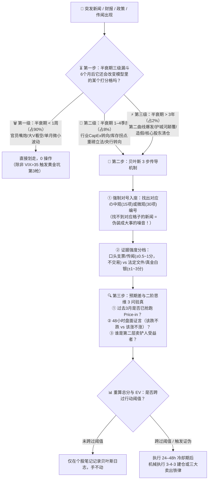

# 📡 新闻过滤与贝叶斯动态更新系统（应对每日海量信息）

> [!abstract] 为什么需要这套系统？
> 世界无时无刻不在变化，财经快讯、大V推文、政策传闻层出不穷。99% 的投资者之所以亏损，是因为没有一套**「信息漏斗」**——把 90% 的短期情绪噪音当成了交易指令，却对真正改变企业基因的 2% 硬核证伪信号视而不见（鸵鸟综合症）。
>
> 本系统联动 [[贝叶斯定理]]、[[注意力残留]] 与 [[心态与行为纪律]]（#6 达尔文黄金法则、#8 事实改变时改变主意、#9 贝叶斯更新、#12 冷却期），将每日突发新闻转化为**客观、冷静的评分调整动作**。

---

## ⏳ 第一道防线：突发新闻「半衰期三级漏斗」（10 秒定性）

每当看到一条令人心跳加速的财经或加密新闻时，先别看标题有多惊悚，只问自己一个问题：
> **“这件事的影响，在 6 个月后还会改变我们 [[宏观周期与行业预期评分模型]] 或 [[选股评分模型]] 里的某一个具体打分项吗？”**

| 级别 | 时间半衰期 | 占比 | 典型新闻示例 | 标准执行动作（联动 [[注意力残留]]） |
| :--- | :---: | :---: | :--- | :--- |
| **🗑️ 第一级：情绪噪音** | **< 1 周** | **90%** | • 某美联储官员发表鹰派/鸽派讲话 • 某知名分析师/大V发推看空某股票 • 非核心数据比预期差 0.1% • 地缘摩擦口水战、短期黑客谣言 | **直接划走，0 操作，连 Obsidian 都不要打开！** *(唯一例外：情绪恐慌把 VIX 砸穿 >35，自动触发我们预设的「第三枪黄金坑挂单」)* |
| **🔎 第二级：中观/周期信号** | **1–4 个季度** | **8%** | • **宏观**：CPI 连续 2 月转向、10Y 实际利率跌破 2.0%、美联储正式结束缩表 • **行业**：云巨头季报宣布削减明年 AI CapEx 增速（朱格拉拐点）、重磅法案（如 GENIUS 法案）正式签署成法 | **进入下方「贝叶斯调分卡」**： 更新中观 15 维度表对应项，检查是否触发组合仓位乘数上调（如从 `0.5x` 升至 `1.0x`）或「第二枪右侧买点」 |
| **⚡ 第三级：基因突变 / 黑天鹅** | **> 3 年** | **2%** | • **正向突变**：第二增长曲线跨过盈亏平衡并释放强经营杠杆（如 Google Cloud 利润率飙至 36%）、重磅新药三期临床大获成功 • **致命黑天鹅**：财务造假、核心护城河被颠覆、战略背书巨头清仓（如 Nvidia 清仓 RXRX）、交易所巨额被盗 | **最高优先级响应**： 立即打开个股笔记复评；若触发「核心假设证伪」或 ⭐ 关键项跌破 2 分，**无条件执行清仓铁律！** |

---

## 🎯 第二道防线：新闻 $\to$ 评分模型「贝叶斯 3 步传导机制」

当确认一条新闻属于**第二级**或**第三级**真信号后，严禁凭感觉拍脑袋说“这是大利好/大利空我要满仓/割肉”，必须严格按 [[贝叶斯定理]]（`先验认知 × 证据强度 = 后验分数`）走完以下三步：

### 第一步：强制对号入座（找不到格子 = 假信号）
必须明确指出：**这条新闻具体改变了【中观 15 维度】、【选股 30 维度】或【加密 21 维度】里的哪一个编号？**
- *例 1*：“美国 10Y TIPS 实际利率从 2.62% 跌至 1.85%” $\implies$ 对号入座：**中观表 `#1 经济象限`、`#2 利率传导`**（从 2 分调升至 4 分）。
- *例 2*：“Google 宣布明年 CapEx 增速减半，单季自由现金流回到 +\$180 亿，重启 \$150 亿回购” $\implies$ 对号入座：**微观表 `#6 股东盈余`（2分$\to$4分）、`#16 回购诚意`（2分$\to$4分）、`#30 资本周期`（1分$\to$3分）**。
- ⚠️ **铁律**：如果一条新闻在群里刷屏，但你在表里**找不到任何一个具体编号能被它改变** $\implies$ 说明它只是包装成大事的“一级噪音”，立刻停止思考！

### 第二步：评估「证据强度」（区分口头支票 vs 真金白银）
为了防止对公关新闻过度反应（Overreaction），或对致命事实反应不足（Underreaction / 鸵鸟心态），按证据硬核程度限制单次调分幅度：

| 证据等级 | 证据来源与性质 | 允许调分幅度 | 交易权限 | 典型正反案例 |
| :--- | :--- | :---: | :--- | :--- |
| **☁️ 弱证据** *(口头支票 / 预期)* | • 管理层电话会口头指引（Guidance） • 无排他性/无首付款的合作备忘录（MOU） • 媒体未证实传闻、法案草案初稿 | **最多 $\pm 0.5 \sim 1$ 分** | **只观察，不交易** | • Circle 管理层口头指引“未来多年 USDC 40% CAGR”（实际 Q3 仅 +8%） • RXRX 宣布与某药企达成早期 AI 探索合作但无大额首付款 |
| **🪨 强证据** *(法定文件 / 真金白银)* | • SEC 10-Q / 10-K 经审计财报硬数据 • 13F 机构持仓披露、Form 4 内部人真金白银买卖 • 正式签署生效的成文法、法院终审判决 • 链上可验证的真实资金流入/销毁 | **直接调 $\pm 1 \sim 3$ 分** | **可触发买卖扳机** | • Nvidia 在 13F 中披露清仓全部 771 万股 RXRX（微观 `#27` 直接砍到 1 分） • Google 10-Q 披露 Cloud 营业利润率达 36.2%，但同时披露单季 CapEx \$514 亿、回购 \$0 |

### 第三步：重算总分与 EV，跨过阈值才动仓位
- **跨过阈值**：调分后，若中观得分跨过 65%/80% 档位，或微观消除了唯一的不及格 ⭐ 项并进入击球区 $\implies$ 结合下方第三道防线，执行预设的【3-4-3 建仓】或【三大卖出】。
- **未跨过阈值**：若调分后总分仍在原区间（如从 52% 升到 55%，仍低于 60%） $\implies$ **只在笔记底部更新一行贝叶斯记录，绝不手痒下单**（守住 [[心态与行为纪律]] #3「20 个打孔位卡片」）。

---

## 🔍 第三道防线：防华尔街叙事陷阱「预期差与二阶思维 3 问」

金融市场里，**决定股价短中期涨跌的从来不是“新闻本身好不好”，而是“新闻 vs 市场原有预期的差值（Expectation Gap）”**。在根据新闻按下买卖按钮前，必须灵魂三问，并遵守 **[[心态与行为纪律]] #12「冷却期原则（推迟 24–48 小时等情绪消退）」**：

### 第 1 问（查抢跑 Price-in）：新闻出来前 1–3 个月，股价是怎么走的？
- **警惕「利好出尽是利空（Sell the News）」**：如果重磅利好公布前，股价已经在过去 1–3 个月暴涨了 50%–200%+（如 [[Zcash ZEC]] 在 ETF 获批前已涨十余倍） $\implies$ 聪明钱早已埋伏完毕，**新闻见报之日，就是庄家找散户接盘派发之时！严禁追高！**
- **捕捉「利空出尽是利好」**：如果利空公布前，股价已经阴跌半年、跌幅超 50%（如 [[Coinbase COIN]] 在 Q3 营收同比降 35% 公布前已跌至 52 周低点） $\implies$ 坏消息早已被充分定价，靴子落地反而是左侧观察良机。

### 第 2 问（看盘面证言 Price Action）：新闻公布后 24–48 小时，K 线和成交量说了什么真话？
> **铁律：永远相信真金白银砸出来的盘面反应，不要相信新闻标题的修饰词。**
- **🟢 看涨背离（该跌不跌，必有大涨）**：爆出惊天大利空（如财报不及预期、行业黑天鹅、加息），当天低开后却被巨量买盘迅速拉红，且 3 个交易日内不再创新低 $\implies$ **极强底部信号（场内恐慌盘已死绝，机构在借利空扫货）**。
- **🔴 看跌背离（该涨不涨，必有大跌）**：爆出炸裂大利好（如业绩暴增、重磅新品、政策红包），当天高开低走、放出天量收大阴线 $\implies$ **极强见顶信号（主力在借利好掩护撤退）**。

### 第 3 问（挖二阶传导 Second-Order Thinking）：第一层受益者人尽皆知，谁是被忽略的「第二层卖铲人」？
- 当重大政策或技术突破发生时，全市场散户第一秒冲进去买的“第一层标的”往往估值已被炒上天；真正的超额收益（Alpha）往往藏在**有定价权、能截留利润的第二层上下游**里。
- *经典战例*：
  - **新闻**：美国通过《GENIUS 稳定币法案》。
  - **一层思维（拥挤且贵）**：冲进去买发币方 [[Circle CRCL]]（估值炒到 50x PE，却不知法案禁付息导致其被迫把 60% 收益分给渠道）；
  - **二阶思维（真正受益）**：法案禁止发行人付息 + 豁免合规托管机构资本占用 $\implies$ 真正坐收 50% 分成与机构托管红利的是渠道霸主 [[Coinbase COIN]] 与短期国债托管巨头！

---

## 📋 附：贝叶斯动态调分记录表（复制到个股笔记底部持续追踪）

每当发生**第二级**或**第三级**重大事件时，在个股笔记的【📈 复盘与贝叶斯更新记录】中追加一行：

| 日期 | 突发事件 / 财报 / 政策（标注半衰期级别） | 对应模型编号 & 证据强度（弱/强） | 先验分数 $\to$ 后验分数 | 48h 盘面证言（该涨不涨 / 该跌不跌 / 正常） | 最终动作（不动 / 触发第X枪 / 证伪清仓） |
| :--- | :--- | :--- | :---: | :--- | :--- |
| *例：2026-10-28* | *Google Q3 财报：Cloud +103% 利润率 36%，但 CapEx $514亿致 FCF 转负（二级+三级）* | *微观 #5(+1), #6(-2), #30(-2)｜强证据(10-Q)* | *质量分 74% 综合分 68%* | *市场因 CapEx 担忧震荡消化* | *入皇冠池，手不动，等 FCF 转正或 $230 扣第二枪* |
| | | | | | |

---

## 🔗 相关笔记

- [[投资清单总览]] — 投资体系总导航
- [[贝叶斯定理]] · [[注意力残留]] · [[结果论陷阱]] · [[事前验尸]] — 底层认知科学基础
- [[心态与行为纪律]] — 重点对照 #6（达尔文黄金法则）、#8（事实改变时改变主意）、#9（贝叶斯法则）、#12（冷却期）
- [[宏观周期与行业预期评分模型]] · [[选股评分模型]] · [[加密资产评分模型]] — 调分对号入座的目标标尺
