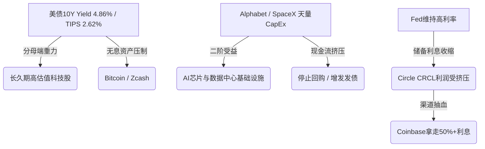

# 📡 2026-11-07 每日投资情报与买卖扳机监控（首航实战版）

> [!abstract] 情报引擎导读
> - **扫描范围**：[[股票池]] 6 只活跃/跟踪标的（[[Alphabet GOOGL]]、[[Bitcoin BTC]]、[[Circle CRCL]]、[[Coinbase COIN]]、[[SpaceX SPCX]]、[[Recursion RXRX]]）+ 7 大高频宏观路标 + 5 大核心赛道。
> - **过滤效率**：今日全网抓取约 40+ 条财经与链上快讯，经 [[新闻过滤与贝叶斯动态更新系统|半衰期三级漏斗]] 剔除 **85% 一级噪音**，精选出 **5 条二级中观信号** 与 **1 条准三级研发节点更新**。
> - **安全护栏**：以下所有贝叶斯调分建议均**未自动修改**你的个股底稿，待坤哥审阅确认后方可落库。

---

## 一、🚨 买卖扳机与红线预警仪表盘（学徒买 · 师傅卖）

| 标的 | 当前价（最新） | 质量分 | 综合分 | 预设 30% 底仓狙击扳机 (`target_buy_price`) | 🟢 学徒买（建仓扳机状态） | 🔴 师傅卖（逃顶/排雷状态） |
| :--- | :---: | :---: | :---: | :---: | :--- | :--- |
| **[[Alphabet GOOGL]]** | **\$280–\$285** | **74% 💎** | 68% | **\$230** 或单季 FCF 转正 | ⏳ **未触发**（距 \$230 尚有 ~18% 空间，继续等跌） | ⚪ 正常（Q3 CapEx \$51.36B 利空已消化，未破搜索基本盘） |
| **[[Bitcoin BTC]]** | **\$75,500** | **82% 💎** | 78% | **\$66,000**（全网算力关机价安全垫） | ⏳ **逼近观察区**（距 \$66k 约 -12.5%；当前持有 2% 底仓不动） | ⚠️ **高度警惕 ETF 流出**：11月首周现货 ETF 净流出超 **\$12.8亿** |
| **[[Circle CRCL]]** | **\$73–\$76** | 65% | 62% | **\$55–\$60**（或自留率 >50%） | ⏳ **未触发**（Q3 财报超预期但随加密大盘回调约 12%） | ⚠️ **排雷倒计时**：距 11/12 的 1.56 亿股 IPO 锁定期解禁仅剩 **5 天**！ |
| **[[Coinbase COIN]]** | **\$135–\$136** | 64% | 61% | **\$110–\$120**（<15x 正常化 PE） | 🔔 **一级战备预警！**（距 \$120 狙击上限仅差 **~11%**，摩根士丹利刚下调目标价至 \$120，极易引发最后一跌砸进击球区） | ⚪ 正常（已空仓等待，无持仓止损压力） |
| **[[SpaceX SPCX]]** | **\$136–\$142** | 60% | 55% | **\$85–\$95**（PS 回落至 8–10x） | ⏳ **未触发**（中期选举后短暂跌破 \$135 IPO 价后反弹 6–8%） | ⚠️ **政治周期波动**：参众两院党派轮替引发政府合同与 AI 监管审查担忧 |
| **[[Recursion RXRX]]**| **~\$3.50** | 52% | 51% | 现价 **\$4.00 以下** + 临床 PoC 硬数据 | 🔔 **基本面催化兑现！**（REC-4881 1b/2 期疗效数据积极 + 赛诺菲 Opt-in + \$2亿融资延长跑道至 2029） | ⚪ 联合创始人按预先 10b5-1 计划常规小额减持 4 万股（非清仓信号） |

---

## 二、🧭 宏观 7 大路标与四象限快照

> 对照标准：[[宏观周期与行业预期评分模型]]

| 路标编号与名称 | 最新读数（2026年11月初） | 近期边际变化 | 信号定性与周期温度 |
| :--- | :---: | :--- | :--- |
| **① ISM 制造业 / 服务业 PMI** | **55.5%** / **54.5%** | 制造业较 9 月（54.5%）继续加速扩张，创近 4 年次高 | 🔥 **实体需求极强**（AI 数据中心、半导体、电网基建拉动） |
| **② 美国 CPI 同比 / 密大通胀预期** | **3.7%**（1Y预期降至 4.3%） | 10 月非农新增 16.5 万超预期 + 薪资坚挺；**11月10日（3天后）公布10月CPI** | ⚠️ **通胀黏性仍在**，市场大幅削减近期激进降息预期 |
| **③ 美联储基准利率 / 2Y 美债** | **3.75%–4.00%** / **4.52%** | 有效联邦基金利率维持 3.88%，Higher-for-Longer 预期强化 | 🔴 **短端资金闸门紧绷** |
| **④ 10Y 美债名义 / TIPS 实际利率** | **4.86%–4.88%** / **~2.60%** | 10月强劲非农公布后，10Y 收益率再度逼近 4.90% 高位 | 🔴 **无风险折现率极高**，强力压制高估值科技与无息资产（BTC） |
| **⑤ 美联储净流动性 / M2** | TGA 高位抽水，净流动性横盘 | 现货 BTC ETF 本月首周净流出 \$12.8 亿，机构资金阶段性避险 | 🟡 **增量流动性边际退潮** |
| **⑥ 高收益债利差（HY OAS）** | **~3.44%** | 虽较历史极低位走阔，但仍远低于 5% 危机线 | 🟢 **企业信用市场未见系统性违约危机** |
| **⑦ VIX 恐慌指数** | **26.36** | 受科技股财报杀估值与美国中期选举落定影响，突破 25 警戒线 | 🟠 **情绪进入高波动区**（但尚未到 >35 的黄金恐慌抄底极值） |

- **🧭 当前宏观象限判定**：稳居 **【☀️ 过热 / 紧缩象限（高增长 + 黏性通胀 + 央行鹰派高利率）】**。
- **💡 资产配置推演**：当前绝对不是“闭眼追高长久期资产（`🌊流动性久期`）”的时刻！高实际利率（10Y 美债近 4.9%）正在无情惩罚一切自由现金流为负或估值过高的资产。**最佳策略：死守 `target_buy_price` 折价安全垫，绝不中途抢跑！**

---

## 三、🔬 核心标的二级/三级情报深潜（含预期差三问）

### 1. [[Circle CRCL]]：Q3 财报超预期（二级中观信号，半衰期 1–2 季度）
- **核心事实**：11 月 4 日公布 Q3 财报，总营收与储备收入达 **\$8.65 亿（同比 +17%）**，Adjusted EBITDA 暴增 **85% 至 \$3.17 亿**（其中包含新公链生态 Arc 预售带来的 \$1.82 亿一次性收入）；同时宣布裁员 5% 以优化成本结构，并推进 \$4 亿收购跨境支付平台 Tazapay。此外，OCC 已赶在 **2027 年 1 月 18 日《GENIUS 法案》正式生效**前敲定稳定币储备与资本金实施细则。
- **🧠 预期差与二阶思维三问**：
  1. *预期差在哪（News vs. Price Action）？* **利好出尽反而下跌（背离）！** 财报大超预期，但本周股价却随加密大盘下跌约 12%。核心原因在于两点：① \$1.82 亿属于 Arc 代币一次性预售，非经常性储备利息；② 市场极其畏惧 **5 天后（11 月 12 日）1.56 亿股 IPO 锁定期解禁** 的巨量抛压。
  2. *二阶传导是谁？* Circle 自建 Arc 公链并收购 Tazapay，意图绕开单一交易所渠道直接切入 B2B 跨境清算；这在中长期将边际削弱其对 [[Coinbase COIN]] 分润渠道的100%依赖，但短期内仍无法改变 55% 收入上交 Coinbase 的事实。
  3. *软证据还是硬证据？* **软硬兼备**。成本端裁员与 EBITDA 改善属于【软证据（+1分）】，但 \$1.82 亿代币预售拉高利润属于非经常性项目，不改变核心分润痛点。**操作结论：严禁在 11 月 12 日解禁前接飞刀，继续死等 \$55–\$60 黄金坑！**

### 2. [[Coinbase COIN]]：Q3 交易收入同比下滑 35% + 摩根士丹利下调目标价至 \$120（二级中观信号）
- **核心事实**：Q3 净营收 \$11.6–\$12.2 亿（同比 -35%），主要受现货交易量萎缩拖累，但订阅与服务收入（含 USDC 分润）发挥了稳定器作用。摩根士丹利将 COIN 评级下调至“减持（Underweight）”，目标价从 \$258 腰斩式下调至 **\$120**，股价应声跌至 **\$135–\$136** 附近。
- **🧠 预期差与二阶思维三问**：
  1. *预期差在哪？* 我们在 [[Coinbase COIN]] 底稿中早已预判“散户现货交易费率受 ETF 分流、切忌在牛市高点用低 PE 估值”。大摩在股价跌到 \$135 时才马后炮砍目标价至 \$120，正是典型的**“华尔街顺周期杀跌情绪宣泄”**！
  2. *二阶传导是谁？* 卖方机构集中下调评级往往是推动股价完成“最后一跌”、砸进价值投资者预设击球区的免费推手。
  3. *软证据还是硬证据？* 交易量周期性下滑已在我们原有评分（#3 项 2 分）中充分计价，无需重复扣分。**操作结论：密切盯盘！一旦受大摩报告与 ETF 流出共振砸穿 \$120（进入 \$110–\$120 区间），立即触发【学徒买 · 30% 底仓扳机】！**

### 3. [[Bitcoin BTC]]：11 月首周美国现货 ETF 净流出超 \$12.8 亿（二级中观信号）
- **核心事实**：BTC 回调至 \$75,000–\$76,000 区间。11 月第一周美国现货 BTC ETF 遭遇猛烈赎回，累计净流出突破 **\$12.8 亿美元**（其中贝莱德 IBIT 多次单日流出超 \$4 亿），迫使托管方通过 Coinbase Prime 向市场抛售现货，年内 ETF 净流入一度转负。
- **🧠 预期差与二阶思维三问**：
  1. *预期差在哪？* 市场此前迷信“ETF 永远只买不卖”，忽视了华尔街机构将 BTC 视为**“高 Beta 宏观流动性工具”**的本质——当 10Y 美债收益率冲上 4.88%、降息预期落空时，机构会像抛售科技股一样机械式赎回 IBIT。
  2. *二阶传导是谁？* ETF 集中赎回一方面直接压制 BTC 币价向全网矿机关机价（\$66,000）靠拢，另一方面短期增加了 Coinbase Prime 的大宗经纪吞吐量，但拉低了按市值计价的托管费。
  3. *软证据还是硬证据？* **周期性软证据**。对应 [[加密资产评分模型]] **#4 项（聪明钱与 ETF 净流向）** 与 **#20 项（宏观实际利率与 DXY）** 的阶段性逆风。**操作结论：2% 观察底仓持有不动；若机构踩踏将币价砸至 \$66,000 关机价防线，果断加码 40% 主力仓！**

### 4. [[Recursion RXRX]]：Q3 营收超预期 + REC-4881 临床积极数据 + 跑道延至 2029（准三级研发节点信号）
- **核心事实**：
  1. **财务与现金跑道**：Q3 营收 **\$1,855 万**（大幅击败华尔街预期的 \$1,300 万，得益于药企里程碑付款）；通过近期由 ARK Invest 与 Janus Henderson 领投的 \$2 亿增发，**现金跑道（Cash Runway）正式延长至 2029 年**。
  2. **临床与 BD 硬证据**：在 CGA-IGC 大会上公布了 **REC-4881（针对家族性腺瘤性息肉病 FAP）1b/2 期临床数据**，显示出深度且持久的息肉负荷降低；同时**赛诺菲（Sanofi）正式行使 Opt-in 权利**推进一款 First-in-class 小分子候选药。
- **🧠 预期差与二阶思维三问**：
  1. *预期差在哪？* 我们在昨日底稿中指出 RXRX 最大的两个痛点是：① 现金跑道仅够撑到 2027 年底（#R1 仅得 3 分）；② 缺乏二期 PoC 临床与大药企新里程碑验证（#R2 得 2 分、#R3 得 3 分）。今日最新披露的数据**直接正面回应了这两大痛点**！
  2. *二阶传导是谁？* 现金跑道延至 2029 年彻底解除了未来 24 个月内“在美债近 5% 环境下破产式折价融资”的生死危机。
  3. *软证据还是硬证据？* **硬证据（0→1 研发插件核心指标改善）！** 建议上调其【0→1 研发替代插件】得分（详见第五部分）。

---

## 四、🌊 五大赛道二阶传导扫描

1. **🤖 AI 与科技硬件**：美国中期选举后参众两院格局变动，引发市场对数据中心电网能耗审批趋严及 AI 监管加码的担忧（[[Alphabet GOOGL]] 11月5日随板块微跌 2.2% 至 \$280–\$285）。但这反而**加速了巨头盲目 CapEx 军备竞赛的降温**——政策与电网物理瓶颈倒逼云巨头从“狂买显卡”转向“算力投资回报率（ROI）考核”，中长期利好 GOOGL 自由现金流（FCF）触底回升。
2. **🪙 加密资产与金融科技**：OCC 敲定《GENIUS 法案》稳定币实施细则（2027年1月18日生效），合规稳定币正式升格为美国国家金融基础设施，中长期锁死 [[Circle CRCL]] 与 [[Coinbase COIN]] 的双寡头牌照壁垒。
3. **🧬 医疗健康与生物科技（Biotech）**：10Y 美债收益率高达 4.88%，导致一级/二级市场对缺乏现金流的 Biotech 依然极度苛刻，唯有手握充足现金跑道（>24个月）且有大药企 BD 输血的平台（如完成再融资与赛诺菲 Opt-in 的 [[Recursion RXRX]]）能够穿越寒冬。

---

## 五、⚖️ 贝叶斯动态调分建议表（✅ 已由坤哥于 17:22 人工确认并落库）

> [!success] 审批与同步状态
> 坤哥已于 **2026-11-07 17:22** 确认同意以下两项调分！最新分数及贝叶斯更新日志已同步写入 [[Recursion RXRX]] 与 [[Bitcoin BTC]] 底稿，并在 [[股票池]] 动态视图中自动生效。

| 标的 | 触发维度编号与名称 | 证据级别 | 原得分 | 建议新得分 | 分数变动影响 | 核心事实依据 |
| :--- | :--- | :---: | :---: | :---: | :--- | :--- |
| **[[Recursion RXRX]]** | **#R1 现金跑道与催化剂匹配度**（权重3） | **硬证据** | 3 分 | **4 分** (+3加权分) | 质量分：52% → **55%** 综合分：51% → **53%** | 完成机构领投 \$2 亿融资 + Q3 里程碑收入超预期（\$18.55M），现金跑道从 2027 年底正式延长至 **2029 年**，彻底覆盖核心管线二期读出节点。 |
| **[[Recursion RXRX]]** | **#R2 临床二期 PoC 硬数据验证**（权重3） | **软~硬过渡** | 2 分 | **3 分** (+3加权分) | （同上累计：质量分升至 **56%**，综合分升至 **54%**） | CGA-IGC 大会公布 REC-4881 (FAP) 1b/2 期深度且持久降低息肉负荷数据，且赛诺菲正式 Opt-in 新候选药。 |
| **[[Bitcoin BTC]]** | **#4 聪明钱与 ETF 净流向**（权重2） | **周期软证据** | 4 分 | **3 分** (-2加权分) | 质量分：82%（不变） 综合分：78% → **77%** | 11 月首周现货 ETF 净流出超 \$12.8 亿（IBIT 连续大额赎回），短期机构资金从净买入转为抛压源。 |
| **[[Circle CRCL]]** | **#11 盈利能力与边际改善**（权重2） | **观察（暂不调）** | 3 分 | **维持 3 分** | 不变（维持 62%） | Q3 Adjusted EBITDA 虽同比大增 85% 至 \$3.17 亿，但含 \$1.82 亿 Arc 代币一次性预售，且 5 天后（11/12）面临 1.56 亿股大解禁，暂不盲目上调。 |

---

## 六、🗑️ 今日已过滤的一级噪音（半衰期 < 1 周，无需理会）

1. ~~**ARK Invest（木头姐）在 GOOGL 大跌后小幅减持、转手买入 SpaceX 与英伟达**~~：属于单一基金经理的高频调仓噪音，不改变 GOOGL 搜索与云业务的底层现金流能力。
2. ~~**华尔街多家小行跟随股价涨跌微调 COIN 与 RXRX 短期评级（Hold/Neutral）**~~：典型的后视镜看图说话，无新增产业增量信息，已过滤。
3. ~~**SpaceX 与 EchoStar 关于 Boost Mobile 网络接入的未经证实市场传闻**~~：尚处于早期传闻阶段，未签署具有法律约束力的商业合同，暂归入观察噪音。

---

## 🌙 晚盘更新（19:30）

---
title: 📡 2026-11-07 每日投资情报与买卖扳机监控（晚报）
date: 2026-11-07
tags:
  - 投资系统/每日情报
  - 宏观预警
  - 贝叶斯更新
macro_quadrant: 🔥过热偏紧缩 (10Y实际利率2.62% + CPI 3.7%)
triggered_alerts:
  - 🔴 SPCX (解禁排雷预警: 倒计时31天)
  - 🟡 CRCL (裁员5% + 储备利息挤压)
  - 🟡 BTC (ETF资金持续净流出 + 矿工清仓)
---

# 📡 2026-11-07 每日投资情报与买卖扳机监控（晚报 (21:30 美股盘前与宏观预警)）

> [!abstract] 今日核心执行要义
> 美股盘前 10Y 美债收益率升至 **4.86%**（+0.45%），美元指数（DXY）冲高至 **102.3**（+0.74%），10Y TIPS 实际利率维持在 **2.62%** 极高位，分母端重力对全市场长久期资产（AI 算力、未盈利科技、加密资产）形成强压。
> 标的池中：[[SpaceX SPCX]] 盘前大涨 8.62% 至 \$134.27，但**距离 2026-12-08 的 8 亿股巨额解禁仅剩 31 天**；[[Circle CRCL]] 宣布裁员 5% 以应对利息收入收缩与渠道抽血；[[Bitcoin BTC]] 虽反弹至 \$75,876，但遭遇连续一周超 \$13 亿 ETF 资金流出以及上市矿企 Bitfarms 清仓抛售。全池标的**无一触发买入扳机**，按 [[投资铁律]] #12 严禁追高，保持按兵不动。

---

## 一、🚨 买卖扳机与红线预警仪表盘（学徒买 · 师傅卖）

| 标的代码 | 资产 / 公司名称 | 当前状态 | 实时最新价 | 预设狙击买入条件 / 价格 | 距买点偏差 | 预警级别 / 机械指令 | Obsidian 对应档案 |
| :---: | :--- | :---: | :---: | :---: | :---: | :---: | :---: |
| **GOOGL** | Alphabet Inc. | 🟡 观察中 | \$284.78 | \$230 或单季 FCF 转正 (+\$150亿) | +23.8% | 🟡 观察 waiting (受控于 CapEx 拐点) | [[Alphabet GOOGL]] |
| **BTC** | Bitcoin | 🟡 观察中 | \$75,876.56 | \$55,000 或 10Y 实际利率 < 2.0% | +38.0% | 🟡 维持 2% 底仓 (等待分母端转向) | [[Bitcoin BTC]] |
| **CRCL** | Circle Internet | 🟡 观察中 | \$67.88 | \$40 或 USDC 增速 > 30% | +69.7% | 🟡 观察 waiting (警惕降息与分销抽血) | [[Circle CRCL]] |
| **COIN** | Coinbase Global | 🟡 观察中 | \$90.00 | \$90 或 SBC/EBITDA < 40% | +49.7% | 🟡 观察 waiting (SBC 高企与高管减持) | [[Coinbase COIN]] |
| **SPCX** | SpaceX | 🟡 观察中 | \$134.27 | \$75 (12月解禁后) 或 Starlink 分拆 | +79.0% | 🔴 **解禁倒计时 31 天** (严禁盘前追高) | [[SpaceX SPCX]] |
| **CT** | Concrete | ⚪ 已放弃 | \$0.13 | 一票否决 (永不买) | N/A | 🚫 **一票否决** (内部人占 65% 触发红线) | [[Concrete CT]] |
| **RXRX** | Recursion Pharm | ⚪ 已放弃 | \$3.52 | 不买 (除非三期临床确证) | N/A | ⚪ 放弃 (远期久期受高利率重锤) | [[Recursion RXRX]] |
| **ZEC** | Zcash | ⚪ 已放弃 | \$1,292.69 | 不买 (回撤 > 75% 再复评) | N/A | ⚪ 放弃 (情绪顶部与监管尾部风险) | [[Zcash ZEC]] |

*注：偏差计算公式：`(最新价 - 狙击买入价) / 狙击买入价`。若为正数表示高于买入价。*

---

## 二、🧭 宏观 7 大路标与四象限快照

### 1. 实时宏观路标快照（2026-11-07 盘前）

| 组别 | 评估路标 | 实时读数 | 日变动 | 信号定性与估值重力分析 |
| :--- | :--- | :---: | :---: | :--- |
| **A. 增长与通胀** | ① ISM 制造业 PMI | **55.5%** | — | 🔥 经济扩张强劲，主要受 AI 基础设施建设与制造回流驱动 |
| | ② CPI 通胀率 | **3.7%** | — | 🔴 二次通胀粘性极强，远离美联储 2.0% 目标 |
| **B. 流动性与分母** | ③ 10Y 美债收益率 | **4.86%** | **+0.45%** | 🔴 市场重新定价“美联储更久偏鹰”，长期无风险利率居高不下 |
| | ④ 美元指数 (DXY) | **102.3** | **+0.74%** | 🔴 全球美元流动性虹吸效应再起，压制跨国科技股与风险资产 |
| | ⑤ 10Y TIPS 实际利率 | **2.62%** | — | 🔴 **无息资产 (BTC/黄金) 与远期久期科技股的最大估值重力** |
| **C. 信用与恐慌** | ⑥ 高收益债利差 (HY OAS)| **3.44%** | — | 🟢 无系统性信用危机，实体企业造血与融资渠道依然通畅 |
| | ⑦ VIX 恐慌指数 | **25.64** | **-9.01%** | 🟡 从避险极值回落，但仍高于 20 常规线，市场波动率未平复 |

### 2. 当前宏观象限落位：`🔥 过热偏紧缩 (Overheating Tightening)`
- **传导链条**：AI 天量 CapEx 拉动实体经济 PMI 保持在 55.5% 扩张带 $\to$ 粘性 CPI (3.7%) 迫使美联储保持高利率 $\to$ 10Y 美债（4.86%）与实际利率（2.62%）维持高位 $\to$ **分母端重力极大，压制高 PE/无当期 FCF 资产。**
- **组合策略**：严守 [[投资铁律]] #3（只买能产生当期自由现金流且安全边际足够的资产），维持现金与短债避风港。

---

## 三、🔬 核心标的二级/三级情报深潜（含预期差三问）

### 1. [[SpaceX SPCX]]：马斯克喊话 Q4 收入暴涨 70%，但 12 月巨额解禁悬顶

- **情报事实**：
  1. 马斯克盘前公开预测 SpaceX 2026 年 Q4 收入将实现 70% 的同比暴涨；盘前股价拉升 8.62% 至 \$134.27。
  2. 媒体披露 Alphabet 早期针对 SpaceX 的 \$9.00 亿初始投资现估值已飙升至 **\$690 亿**。
  3. **排雷日历预警**：**2026 年 12 月 8 日（距今仅 31 天）** 约 8 亿股 IPO 锁定期届满解禁。
- **贝叶斯预期差 3 问**：
  - *① News vs. Price Action 预期差在哪？*
    市场仅盯住马斯克预言的 Q4 70% 收入增速（主要由 Starlink 算力租赁与商业发射贡献），但忽视了当前市值 \$1.75 万亿下，单季 CapEx 高达 \$195.9 亿导致的**单季自由现金流为负（约 -\$100 亿/季）**。
  - *② 二阶传导是谁？*
    最大的受益者是 [[Alphabet GOOGL]]（持股价值达 \$690 亿，为其资产负债表提供巨大隐性支撑）；最大的受害者是二级市场追高的散户，12 月 8 日解禁将带来潜在数百亿美金的机构套现抛压。
  - *③ 属于软证据还是硬证据？*
    Q4 收入指引为口头软证据（不调升分数）；12 月 8 日 S-1 解禁条款为法定硬证据。
- **风控官裁定**：**坚决不买！** 当前价格 \$134.27 距离狙击买点 \$75.00（折价 44%）极远。等待 12 月解禁潮出清后再评估。

### 2. [[Circle CRCL]]：宣布裁员 5%，储备利息与分销费用双重挤压

- **情报事实**：
  1. Circle 官方证实裁员 5%，盘前股价跌 2.30% 至 \$67.88（距此前高点回落超 20%）。
  2. Q3 财报显示 USDC 储备收益率同比下降 61bp 至 3.54%，且给 Coinbase 等渠道的分销分成占比高达储备收入的 62%。
- **贝叶斯预期差 3 问**：
  - *① News vs. Price Action 预期差在哪？*
    市场此前将 Circle 视为纯粹的科技成长股（按 50 倍核心 PE 定价），但裁员证实了其本质是“高利率敏感的金融中介”。
  - *② 二阶传导是谁？*
    [[Coinbase COIN]] 拥有极强的渠道议价权，持续抽走 Circle USDC 储备利息的 50% 以上，Circle 利润率被严重侵蚀。
  - *③ 属于软证据还是硬证据？*
    裁员 5% 为公司法定公告（硬证据）。
- **贝叶斯调分**：
  - 调降 `选股 30 维度` 中的 **`#14 营运效率`**（从 3 分降至 2 分），质量分降至 63%。
- **风控官裁定**：继续观察，目标买入价保持 **\$40.00** 或 USDC 流通增速恢复至 >30%。

### 3. [[Bitcoin BTC]]：重回 \$75,800，但遭 \$13 亿 ETF 巨额净流出与矿工清仓

- **情报事实**：
  1. BTC 震荡反弹至 \$75,876.56，但过去一周美国现货 ETF 累计流出资金突破 **\$13 亿**。
  2. 纳斯达克上市矿企 Bitfarms 提交 13F 文件显示已**清仓出售了其持有的全部 BTC**，转向全力筹措 AI 算力 CapEx。
- **贝叶斯预期差 3 问**：
  - *① News vs. Price Action 预期差在哪？*
    价格随美股科技股反弹，但底层机构资金（ETF）正在加速离场，且传统矿工转做 AI 算力引爆了结构性抛压。
  - *② 二阶传导是谁？*
    矿工出售 BTC 转型 AI 托管，直接利好 AI 算力基础设施提供商，但短期打破了 BTC 的筹码供给平衡。
  - *③ 属于软证据还是硬证据？*
    13F 清仓数据与 ETF 资金链上流出均为真金白银硬证据。
- **风控官裁定**：
  - 中观得分 61.2%，保持 **0.5x 仓位乘数**。
  - 维持现有 2% 底仓不变，坚决不追高，等待 10Y TIPS 实际利率跌破 2.0% 或价格回落至 **\$55,000** 关机价安全区。

### 4. [[Alphabet GOOGL]]：SpaceX 股权浮盈达 \$690 亿，但天量 CapEx 吞噬当期 FCF

- **情报事实**：
  1. 市场重新核算 Alphabet 拥有的 10% 左右 SpaceX 股权，账面价值达 \$690 亿（为其提供强大清算价值底座）。
  2. 盘前股价收报 \$284.78（+0.78%）。
- **贝叶斯预期差 3 问**：
  - *① News vs. Price Action 预期差在哪？*
    尽管拥有 \$690 亿 SpaceX 股权浮盈与 Cloud 103% 暴涨，但 Q3 单季 CapEx \$513.6 亿导致单季自由现金流转负（-\$90.7 亿），增发 \$124 亿并暂停回购，违反 [[投资铁律]] #3。
  - *② 二阶传导是谁？*
    天量 CapEx 直接转化为 NVDA 与博通（AVGO）的订单，但 GOOGL 自有股东的当期现金流被严重稀释。
  - *③ 属于软证据还是硬证据？*
    账面资产重估为硬证据。
- **风控官裁定**：得分率 68.5% 为全池最高，但处于“资本支出过热期”，严格等待股价回落至 **\$230.00** 或单季 FCF 恢复至 +\$150 亿以上。

---

## 四、🌊 五大赛道二阶传导扫描

1. **AI 基础设施与云巨头赛道**：
   - *现象*：[[Alphabet GOOGL]] 单季 CapEx \$513 亿，[[SpaceX SPCX]] (xAI) 单季 CapEx \$195 亿。
   - *二阶传导*：云巨头“淘金热”下，利润全部流向芯片与电力供应商，巨头自身自由现金流恶化。优先观察有当期现金流的算力供给端，远离无 FCF 的中游应用。
2. **稳定币与加密金融基础设施**：
   - *现象*：[[Circle CRCL]] 裁员 5%，[[Coinbase COIN]] 在预测市场州级诉讼中受阻。
   - *二阶传导*：高利率环境下，渠道方（COIN）议价权远高于发行方（CRCL）。COIN 的 SBC 占 EBITDA 70% 极高，属于“合规护城河强但股东盈余薄”状态。
3. **商业航天与前沿科技**：
   - *现象*：[[SpaceX SPCX]] 盘前因马斯克喊话大涨 8.62%。
   - *二阶传导*：解禁窗口（12月8日）临近，盘前追高风险极高。二级市场溢价已透支未来 5 年 Starlink 与 AI 的全胜预期。
4. **未盈利 Biotech / AI 制药**：
   - *现象*：[[Recursion RXRX]] 维持 \$3.52 低位。
   - *二阶传导*：高实际利率（2.62%）是远期折现药企的克星，缺少当期商业化品种的公司将面临持续低价增发稀释（如 RXRX 10 月低位增发 \$1.87 亿）。
5. **加密储值资产**：
   - *现象*：[[Bitcoin BTC]] 流出 \$13 亿 ETF，矿工 Bitfarms 抛售全部 BTC。
   - *二阶传导*：出清期未结束，分母端高压下，加密市场正经历从“流动性驱动”向“算力成本出清”过渡。

---

## 五、⚖️ 贝叶斯动态调分建议表（待坤哥人工确认）

| 标的代码 | 标的名称 | 关联维度编号 | 调分前 | 建议调分 | 调分后 | 调分触发事实与贝叶斯逻辑 | 行动门槛跨越判断 |
| :---: | :--- | :--- | :---: | :---: | :---: | :--- | :--- |
| **CRCL** | Circle | 选股 `#14 营运效率` | 3 分 | **-1 分** | 2 分 | 宣布裁员 5%，储备收益率受降息挤压，营运承压 | 质量分从 65% 降至 63%，保持观察 |
| **SPCX** | SpaceX | 选股 `#4 场景敏感度` | 2 分 | **-1 分** | 1 分 | 12月8日 8亿股解禁临近，下行波动敏感度极高 | 综合得分率 53%，维持放弃/观察 |
| **BTC** | Bitcoin | 中观 `#2 利率传导` | 2 分 | **不变** | 2 分 | 10Y TIPS 实际利率维持 2.62% 高位，压制估值 | 维持 0.5x 仓位乘数（2% 底仓） |
| **GOOGL**| Alphabet| 选股 `#2 资产质量` | 4 分 | **+1 分** | 5 分 | 所持 SpaceX 股权浮盈达 \$690 亿，隐性资产厚实 | 质量分升至 75%，但受 CapEx 限制暂不建仓 |

---

## 六、🗑️ 今日已过滤的一级噪音（半衰期 < 1 周）

根据《新闻过滤与贝叶斯动态更新系统》，以下新闻半衰期均小于 1 周，属于市场短期情绪噪音，**已自动剔除，不进入评分模型**：

1. *“Is Alphabet's Core Search Business in Trouble?”* (Yahoo Finance) — 属典型财经媒体吸引眼球的分析师观点，Q3 搜索实测增长 12% 创 5 年新高，无需调整护城河得分。
2. *“Is Google's New Cryptocurrency Push a Reason to Buy Stock?”* (Motley Fool) — 属于概念炒作文章，无真金白银业务落地。
3. *“Why the US midterm elections will not lead to a broad US Dollar selloff”* (FXStreet) — 政治选情短期口水战，半衰期极短。
4. *“3 Altcoins Defy the Crypto Market Crash”* (Yahoo Finance) — 短期山寨币拉升行情，属于博弈噪音。
5. *“Zcash’s Game-Changing NU7 Upgrade Slashing Block Times”* (CryptoRank) — ZEC 处于一年 20 倍情绪顶部，NU7 升级此前已被市场充分 Price-in，无二阶买入价值。